# Design: M1 Data Model

**Ticket:** T-01 (Design the extensible data model)
**Spec:** [m1-foundation.md](../spec/m1-foundation.md), with [m1-auth-permissions.md](../spec/m1-auth-permissions.md), [m1-system-admin.md](../spec/m1-system-admin.md) and [m1-i18n-theme-seed.md](../spec/m1-i18n-theme-seed.md)
**Status:** Draft, waiting for approval. T-02 and later tickets start after the ER diagram is approved.

This document is the design only. No table, migration or code is added by T-01. T-02 writes the Drizzle schema and the first migration from it.

## Goals

The model answers each T-01 acceptance criterion:

| Acceptance criterion | Where it is answered |
| --- | --- |
| A Business holds many shops; an account can later belong to several Businesses | `organization` 1-N `shop`; `user` N-N `organization` through `member` |
| Permissions stored per user, module and level | `member_permission` (member, module, level), with `module` and `permission_level` as lists |
| Taxpayer profile and platform connections are their own records | `taxpayer_profile` and `platform_connection` are separate tables, not columns of Business or shop |
| Seller type is a list (Individual, Household business) that can gain Company later | `seller_type` lookup table; Company is one new row |
| ER diagram approved | The diagram below, reviewed by the product owner |

The spec also asks the diagram to cover the record source (`record_source`) and to stay open to orders and costs (M4) and to product attributes as configuration. Both are covered in [Extending the model](#extending-the-model).

## ER diagram

Tables marked **(auth)** are owned by Better Auth (core and Organization plugin). TopTop adds a few columns to them through Better Auth `additionalFields`. All other tables are TopTop tables.

```mermaid
erDiagram
    user ||--o{ session : "signs in with"
    user ||--o{ account : "links (Google)"
    user ||--o{ member : "belongs through"
    organization ||--o{ member : "has"
    organization ||--o{ invitation : "issues"
    user ||--o{ invitation : "invites (inviter)"
    organization ||--o{ shop : "holds"
    user ||--o| taxpayer_profile : "files tax as"
    shop ||--o| platform_connection : "connects through"
    member ||--o{ member_permission : "is granted"
    module ||--o{ member_permission : "for"
    permission_level ||--o{ member_permission : "at"
    seller_type ||--o{ organization : "classifies"
    seller_type ||--o{ taxpayer_profile : "taxpayer type"
    platform ||--o{ shop : "sells on"
    platform ||--o{ platform_connection : "via"
    record_source ||--o{ shop : "source of"
    user ||--o{ system_audit_log : "acts (System Admin)"

    user {
        text id PK "auth"
        text email UK
        text name
        text image
        bool email_verified
        text status "added: active or suspended"
        timestamptz created_at
        timestamptz updated_at
    }
    session {
        text id PK "auth"
        text user_id FK
        text token UK
        text active_organization_id "the request's Business"
        timestamptz expires_at
    }
    account {
        text id PK "auth"
        text user_id FK
        text provider_id "google"
        text account_id
    }
    organization {
        text id PK "auth: one Business"
        text name UK
        text slug UK
        text seller_type_code FK "added"
        text status "added: active or suspended"
        timestamptz created_at
    }
    member {
        text id PK "auth"
        text organization_id FK
        text user_id FK
        text role "admin or user"
        timestamptz created_at
    }
    invitation {
        text id PK "auth"
        text organization_id FK
        text email
        text role "admin or user"
        text status "invited, accepted, revoked, expired"
        text inviter_id FK
        timestamptz expires_at "7 days"
    }
    shop {
        uuid id PK
        text business_id FK "RLS"
        text name
        text platform_code FK
        text status "active or inactive"
        text source_code FK
        timestamptz created_at
        timestamptz updated_at
    }
    platform_connection {
        uuid id PK "created in M2"
        text business_id FK "RLS"
        uuid shop_id FK, UK
        text platform_code FK
        text status "connected, expired, error, disconnected"
        text external_shop_id
        text external_shop_name
        text access_token_encrypted
        text refresh_token_encrypted
        timestamptz token_expires_at
        timestamptz refresh_token_expires_at
        text_array scopes
        timestamptz connected_at
        timestamptz disconnected_at
        timestamptz last_sync_at
        text last_sync_status "running, succeeded, failed"
        text last_error
        timestamptz last_error_at
        timestamptz created_at
        timestamptz updated_at
    }
    taxpayer_profile {
        uuid id PK "created in M5"
        text user_id FK, UK "RLS: the owner"
        text taxpayer_type_code FK "required"
        bool has_salary_income "required"
        text tax_code "optional"
        text business_details "optional"
        text tax_status "optional"
        text notes "optional"
        timestamptz created_at
        timestamptz updated_at
    }
    member_permission {
        uuid id PK
        text business_id FK "RLS"
        text member_id FK
        text module_code FK
        text level_code FK
        timestamptz created_at
        timestamptz updated_at
    }
    module {
        text code PK "overview ... reports"
        int sort_order
        bool grantable_to_user "false for tax"
    }
    permission_level {
        text code PK "view; edit later"
        int rank
    }
    seller_type {
        text code PK "individual, household_business"
        int sort_order
        bool is_active
    }
    platform {
        text code PK "tiktok_shop, shopee"
        int sort_order
    }
    record_source {
        text code PK "platform_api, import_file, manual_entry"
    }
    system_audit_log {
        uuid id PK
        text actor_user_id FK
        text action
        text target_type "user, business, invitation"
        text target_id
        text business_id "nullable"
        jsonb details
        timestamptz created_at
    }
```

## Tables

### Kinds of table

| Kind | Tables | Business id | RLS |
| --- | --- | --- | --- |
| Auth (Better Auth) | `user`, `session`, `account`, `verification`, `organization`, `member`, `invitation` | `organization_id` on `member` and `invitation` | No, protected by the shared helper (decision D-1, see [Isolation](#isolation-q-fnd-2)) |
| Tenant | `shop`, `platform_connection`, `member_permission` | `business_id`, not null | Yes, by Business |
| Personal | `taxpayer_profile` | none; `user_id`, not null | Yes, by owner (decision D-2) |
| Lookup lists | `module`, `permission_level`, `seller_type`, `platform`, `record_source` | none | No; read-only for the app role, filled by migrations |
| System | `system_audit_log` | optional, for reference only | No; written and read only by System Admin code |

### Business (`organization`)

- A Business is one Better Auth organization (Plan, Decisions). The table keeps Better Auth's name `organization`; code and docs call it Business.
- Added fields: `status` (active, suspended; Q-SYS-5) and `seller_type_code` (the seller type list).
- `name` is required and unique (spec edge case "duplicate name").
- Time zone and currency are not stored in M1: the app uses fixed Vietnam time (Q-FND-5) and VND. Brief 6.1 lists both as Business settings, so a later milestone adds the columns.

### Account and membership (`user`, `member`)

- `user` is one Google account. Added field: `status` (active, suspended) for T-125.
- `member` joins a user to a Business with a role. This is what lets an account belong to several Businesses later, each with its own role and grants (Brief 2.5). M1 allows one Business per account (Q-AUTH-6); the server checks this when an invitation is accepted. There is no unique index on `member.user_id`, so lifting the rule later needs no migration.
- Roles in `member.role`: `admin` and `user`. One Admin per Business (Q-AUTH-10) is checked by the server and backed by a partial unique index on `member (organization_id) where role = 'admin'`.
- The System Admin is **not** stored as a role. It is the account whose email equals `SYSTEM_ADMIN_EMAIL`, read from configuration on every request (Q-SYS-1, Q-SYS-1b). It has no `member` row, so it has no Business context and every tenant query returns no rows for it (T-17).

### Invitations (`invitation`)

- Better Auth's invitation table, with the statuses of Q-AUTH-4: invited, accepted, revoked, expired. `expires_at` is 7 days after creation.
- Q-SEC-6 asks that the link token is stored only as a hash. Better Auth uses the invitation id as the link token by default, so T-11 must either hash it through a Better Auth hook or add a `token_hash` column. This design leaves the choice to T-11 and only reserves the column name `token_hash`.

### Per-module permissions (`member_permission`, `module`, `permission_level`)

- One row per (member, module): `unique (member_id, module_code)`. The row's `level_code` says the level. Today the only stored level is `view`.
- **No row means No Access.** This keeps deny-by-default in the data: a new User has no rows (Q-AUTH-2), and revoking a module deletes its row.
- The grant is keyed by `member`, not by `user`, so the same person can hold different grants in different Businesses later.
- An Admin's access comes from the role, not from rows: an Admin always has every module and it cannot be reduced (Q-AUTH-2, T-13). New modules then reach Admins without a data change.
- Tax can never be granted to a User (T-16). Two guards: the server rejects it, and the database rejects it through `module.grantable_to_user = false` (a check enforced by a trigger, or simply `check (module_code <> 'tax')`).
- Adding a level (Edit) or a module is one new row in the lookup list. Adding a role is one new value of `member.role`. Neither changes the structure (Brief 2.5).
- `business_id` is repeated on the row for RLS. A composite foreign key `(business_id, member_id)` to `member (organization_id, id)` makes it impossible for a grant to point at a member of another Business.

### Shops (`shop`)

- A Business holds one or more shops. Each shop sells on one platform (`platform_code`).
- `status`: active or inactive (deactivate in M2).
- `source_code`: how the shop record was created (manual entry in M1 and M2, platform API once a connection creates it).
- `unique (business_id, name)` so one Business cannot have two shops with the same name.
- `unique (business_id, id)` and `unique (business_id, id, platform_code)` are created in M1, although `id` alone is already unique. Later tables point at them with composite foreign keys: `platform_connection` (M2) and the order tables (M4). Creating them in M1 means those milestones add tables without touching `shop`.

### Platform connections (`platform_connection`)

Created in M2 by a new migration (decision D-3). Full definition, so M2 adds the table as designed:

| Column | Type | Null | Default | Notes |
| --- | --- | --- | --- | --- |
| `id` | `uuid` | no | `gen_random_uuid()` | Primary key |
| `business_id` | `text` | no | | References `organization(id)`; RLS key |
| `shop_id` | `uuid` | no | | The connected shop |
| `platform_code` | `text` | no | | References `platform(code)`; must equal the shop's platform |
| `status` | `text` | no | `'connected'` | Check: `connected`, `expired`, `error`, `disconnected` |
| `external_shop_id` | `text` | yes | | Shop id on TikTok Shop or Shopee |
| `external_shop_name` | `text` | yes | | Shop name as the platform returns it |
| `access_token_encrypted` | `text` | yes | | Ciphertext; null when disconnected |
| `refresh_token_encrypted` | `text` | yes | | Ciphertext; null when disconnected |
| `token_expires_at` | `timestamptz` | yes | | When the access token expires |
| `refresh_token_expires_at` | `timestamptz` | yes | | When the refresh token expires (reconnect needed) |
| `scopes` | `text[]` | yes | | Permissions the platform granted |
| `connected_at` | `timestamptz` | yes | | Last successful authorization |
| `disconnected_at` | `timestamptz` | yes | | Last disconnect |
| `last_sync_at` | `timestamptz` | yes | | Last completed sync (once sync exists) |
| `last_sync_status` | `text` | yes | | Check: `running`, `succeeded`, `failed` |
| `last_error` | `text` | yes | | Short error cause for the status screen; never a token |
| `last_error_at` | `timestamptz` | yes | | When the last error happened |
| `created_at` | `timestamptz` | no | `now()` | |
| `updated_at` | `timestamptz` | no | `now()` | |

Keys and constraints:

- `unique (shop_id)`: one connection per shop. A disconnect sets `status = disconnected`, clears the tokens and keeps the row; it does not delete the shop.
- Foreign key `(business_id, shop_id, platform_code)` to `shop (business_id, id, platform_code)`: the connection stays in the shop's Business and on the shop's platform, even if app code passes a wrong id.
- Partial unique index `(platform_code, external_shop_id) where external_shop_id is not null`: one platform shop cannot be connected to two Businesses.
- Index `(business_id)`; index `(status)` for the token refresh and sync jobs.

Security:

- RLS by Business, the same policy as the other tenant tables.
- Tokens are encrypted in the app (AES-GCM) with a key from an environment variable (Q-SEC-3), are never sent to the browser and are never logged. Only server code that calls the platform decrypts them.
- Background jobs (token refresh, sync from M9) run the shared helper once per Business, so they also go through RLS. How a job lists the connections that are due is decided with the sync tickets; it does not change this table.

What it shows: connection status, connected shop, last sync time, sync status and errors (Brief 6.3).

### Taxpayer profile (`taxpayer_profile`)

Created in M5 by a new migration, with the Tax epic (decision D-3). Its own record, apart from Business and shop (Brief, Module 07).

- **It belongs to the person, not to the Business** (decision D-2). The profile describes who the shop owner is for tax purposes, and one person may run several shops and, later, several Businesses.
- The Business finds its taxpayer through its Admin: Business → `member` with role `admin` → `user` → `taxpayer_profile`. With one Admin per Business (Q-AUTH-10) this is always one profile, and no link column is needed on `organization`.

| Column | Type | Null | Default | Notes |
| --- | --- | --- | --- | --- |
| `id` | `uuid` | no | `gen_random_uuid()` | Primary key |
| `user_id` | `text` | no | | References `user(id)`; unique; RLS key |
| `taxpayer_type_code` | `text` | no | | References `seller_type(code)`; prefilled from the Business seller type (D-4) |
| `has_salary_income` | `boolean` | no | | Also earns a salary, or only runs the business |
| `tax_code` | `text` | yes | | Tax identification number where applicable |
| `business_details` | `text` | yes | | Relevant business information (registered name, address) |
| `tax_status` | `text` | yes | | Tax status, free text in this version |
| `notes` | `text` | yes | | |
| `created_at` | `timestamptz` | no | `now()` | |
| `updated_at` | `timestamptz` | no | `now()` | |

Keys and constraints:

- `unique (user_id)`: one profile per person.
- Foreign keys to `user(id)` and `seller_type(code)`, both `on delete restrict` (nothing is hard-deleted, T-125).
- The format of `tax_code` is checked by the Zod schema on the server, not by a database check. Vietnam's rules for tax codes have changed (10 or 13 digits, and the 12-digit personal id number for individuals), and a schema change is cheaper than a migration.
- Required and optional fields follow the Plan ticket "Taxpayer profile" (Required: taxpayer type and salaried income).

Security:

- RLS by owner, not by Business: `using (user_id = current_setting('app.user_id', true))` and the same `with check`. The shared helper sets `app.user_id` to the signed-in user, next to `app.business_id`, in the same transaction, from M1 on (T-02). M5 only adds the policy.
- Who can read and write it: only the owner, and only while acting as the Admin of a Business (the Tax module is Admin only, T-16). A User never reaches it. The System Admin never reaches it either (T-17), including in the System Console account details.
- Business tax records added with the Tax epic (tax-tracking revenue, platform-withheld tax, tax payments, reminders) are tenant tables with `business_id`, because they come from that Business's shops. Only the profile is personal.
- The app does not calculate tax; the table only stores information.

### Adding the later tables without changing M1 tables

Both tables only point at rows that exist in M1; no M1 table points at them. So M2 and M5 each add one new migration with the table, its constraints, its indexes, its RLS policy and its grant to the app role, and no `alter table` on an M1 table. What they rely on is already in M1:

| Needed later | Prepared in M1 |
| --- | --- |
| `platform_connection` foreign key to the shop, Business and platform | `unique (business_id, id, platform_code)` on `shop`; `platform` list |
| `platform_connection` RLS | The shared helper and `app.business_id` (T-02) |
| `taxpayer_profile.taxpayer_type_code` | `seller_type` list |
| `taxpayer_profile` RLS by owner | The shared helper also sets `app.user_id` (T-02) |
| `taxpayer_profile.user_id` | `user.id` (Better Auth) |

### Seller type (`seller_type`)

- A lookup table, not a Postgres enum: rows `individual` and `household_business`. Company is added later as one row (`company`), with no change to any table that refers to it.
- Used by `organization.seller_type_code` and by `taxpayer_profile.taxpayer_type_code`. They are separate columns (decision D-4).
- `is_active` lets a type be listed but not offered yet.
- Labels are not stored in the table. The code is a key into the i18n catalog (`src/i18n/messages`), so the two languages stay in one place.

### Record source (`record_source`)

- Three codes: `platform_api`, `import_file`, `manual_entry` (T-03).
- Every TopTop table whose rows can come from outside the app has `source_code not null` referencing this list. In M1 that is `shop`. Orders, products, costs, settlements and other business records added from M2 on follow the same rule.
- The display component (T-03) still handles a missing value as "unknown source" (spec edge case), for data read from older or external rows.
- When later tables need more detail (which import file, which external id), they add `source_ref` next to `source_code`.

### System Admin log (`system_audit_log`)

- Who, what and when for each System Admin action (Q-SYS-6, T-125): invitations, Business creation, status changes.
- Not a tenant table: it belongs to the System Console. The log viewer is M7.
- The data change log for Admin edits (T-08) is M2 and is not part of this design.

## Isolation (Q-FND-2)

- Every tenant table has `business_id text not null references organization(id)` and an index that starts with `business_id`.
- RLS is enabled and forced on every tenant table, with one policy for all commands:
  `using (business_id = current_setting('app.business_id', true))` and the same `with check`.
- The shared query helper (T-02) opens a transaction, runs `select set_config('app.business_id', $1, true)` with the Business of the session (`session.active_organization_id`, after the server checks the membership) and `select set_config('app.user_id', $2, true)` with the signed-in user, and runs the queries inside it. Without those settings `current_setting` returns null, the policy matches nothing, and the query returns no rows.
- The personal table `taxpayer_profile` has no `business_id`; its policy compares `user_id` with `app.user_id` instead (see [Taxpayer profile](#taxpayer-profile-taxpayer_profile)).
- The app connects as a role that does not own the tables and has no `BYPASSRLS`. Migrations run as the owner role.
- Composite foreign keys (`(business_id, member_id)`, `(business_id, shop_id)`) stop a row from referring to a row of another Business, even if app code passes a wrong id.
- Auth tables are read by Better Auth before any Business is chosen (sign-in, accepting an invitation, listing memberships), so they cannot depend on `app.business_id`. They have no tenant RLS (decision D-1). Code outside the auth layer reads `member` and `invitation` only through the shared helper, which adds the Business filter. T-02 adds a test that the helper returns only the current Business's members and invitations, and rejects a call with no Business.

## Conventions

- TopTop tables use `uuid` primary keys (`gen_random_uuid()`). Better Auth tables keep its `text` ids, so `business_id` and `member_id` are `text`.
- Column names are snake_case in the database (Drizzle `casing: 'snake_case'`), camelCase in TypeScript.
- Every TopTop table has `created_at` and `updated_at` (`timestamptz`, UTC). Display converts to Vietnam time (Q-FND-5).
- Statuses with a fixed, small set of values (`status` columns) are `text` with a check constraint. Lists that are expected to grow (seller type, module, level, platform, source) are lookup tables.
- Money columns, from M4 on, are `bigint` VND with no decimals (Q-ENG-7).
- Nothing is hard-deleted when a Business or account is suspended (T-125).

## What M1 creates

The design covers everything above. M1 migrations create only what M1 tickets use:

| Table | Created in | Why |
| --- | --- | --- |
| Better Auth tables, with the added fields | M1 (T-02, T-09) | Sign-in, Businesses, invitations |
| `module`, `permission_level`, `seller_type`, `platform`, `record_source` | M1 (T-02) | Lists used by M1 tables and the seed |
| `member_permission` | M1 (T-13) | Per-module grants |
| `shop` | M1 (T-02) | The seed has shops (Q-SEED-2) and the header shows them |
| `system_audit_log` | M1 (T-125) | Q-SYS-6 |
| `platform_connection` | M2 (connect TikTok Shop and Shopee) | No connection exists before M2 |
| `taxpayer_profile` | M5 (Tax epic E12, ticket "Taxpayer profile") | No Tax screen in M1 |

Both later tables stay in the ER diagram, fully defined, so the design is complete (decision D-3). See [Adding the later tables without changing M1 tables](#adding-the-later-tables-without-changing-m1-tables).

Planned migration order (Drizzle Kit, each a new file in `drizzle/`, Q-FND-3):

1. M1: Better Auth tables with the added fields.
2. M1: lookup lists and their rows; `shop`, `member_permission`, `system_audit_log`; the app role, grants and RLS policies.
3. M2: `platform_connection` with its constraints, indexes, RLS policy and grant.
4. M5: `taxpayer_profile` with its constraints, RLS policy and grant.

## Extending the model

How later milestones attach, without restructuring the tables above:

- **Orders and costs (M4, Q-FND-1).** New tenant tables such as `order` and `order_line` carry `business_id`, `shop_id` (composite foreign key to `shop`), `source_code`, and money as `bigint`. RLS uses the same policy.
- **Product attributes as configuration (Brief 2.5).** An `attribute_definition` table per Business (key, data type, applies to) and the values in a `jsonb` column on `product`, instead of fixed columns for one industry.
- **Several Businesses per account.** Remove the server check of Q-AUTH-6; the Business selector switches `session.active_organization_id`. No table changes.
- **Company seller type.** Insert `company` into `seller_type`.
- **Edit level, more roles.** Insert into `permission_level`; add a value to `member.role`.
- **More platforms.** Insert into `platform`.

## Assumptions

These are taken as the default in this draft. Each can be changed before approval.

1. The Better Auth table names stay as Better Auth defines them (`organization`, `member`); the domain name Business is used in code and docs.
2. An Admin's access to all modules is derived from the role and not stored as rows.
3. "No Access" is the absence of a row, not a stored row.
4. One Business per account (Q-AUTH-6) is a server check, not a unique index.
5. Platform tokens are encrypted in the app with a key from an environment variable.
6. The invitation token hash (Q-SEC-6) is decided in T-11.
7. Time zone and currency are not Business columns in M1.

## Decisions

| ID | Answer | Date |
| --- | --- | --- |
| D-1 | `member` and `invitation` have no tenant RLS, because Better Auth reads them before a Business is chosen. Code outside the auth layer reads them only through the shared helper, and T-02 tests the helper. | 2026-11-27, product owner |
| D-2 | The taxpayer profile belongs to the person (the shop owner's account), not to the Business, so the profile shows who the owner is for tax. RLS on it compares `user_id` with the signed-in user. | 2026-11-27, product owner |
| D-3 | M1 does not create `platform_connection` (M2) or `taxpayer_profile` (M5). Both are fully defined in this design, and M2 and M5 add them with new migrations, without changing M1 tables. | 2026-11-27, product owner |
| D-4 | Seller type (on the Business) and taxpayer type (on the taxpayer profile) are two separate columns that use the same `seller_type` list. The taxpayer type is prefilled from the seller type of the owner's Business and can be changed. | 2026-11-27, product owner |
